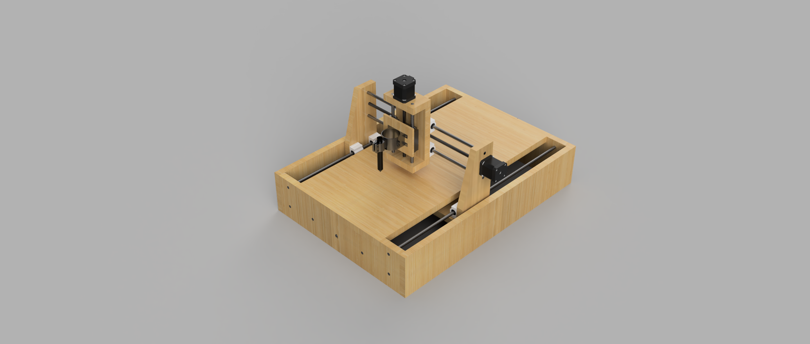

# 3-DOF CNC Image Plotter

A three-axis Cartesian CNC drawing robot designed to convert digital images into physical drawings on paper using stepper motors, lead screws, and an Arduino-based motion controller.

## Table of Contents

- [Overview](#overview)
- [Objectives](#objectives)
- [Features](#features)
- [System Specifications](#system-specifications)
- [Working Principle](#working-principle)
- [Hardware and Materials](#hardware-and-materials)
- [Mechanical Assembly](#mechanical-assembly)
- [Electronics and Control](#electronics-and-control)
- [Software Requirements](#software-requirements)
- [Operating Procedure](#operating-procedure)
- [Applications](#applications)
- [Repository Structure](#repository-structure)
- [Limitations and Future Improvements](#limitations-and-future-improvements)
- [Project Status](#project-status)

---

## Overview

The **3-DOF CNC Image Plotter** is a robotic drawing system that uses three linear axes (X, Y, and Z) to position a drawing tool over a flat surface and reproduce digital images and patterns.

The system follows an image-to-G-code workflow using Inkscape for image processing and G-code generation and Universal G-code Sender (UGS) for sending motion commands to the CNC controller. Stepper motors drive the linear mechanisms to execute the drawing paths.

The mechanical design consists of a rigid base, gantry supports, linear guide rods, lead screws, carriage plates, motor mounts, and a Z-axis pen holder.

The project demonstrates the integration of mechanical design, CAD modelling, CNC motion control, and robotic automation.

## Objectives

- Design a three-degree-of-freedom Cartesian drawing robot.
- Implement controlled movement along the X, Y, and Z axes.
- Convert digital images into machine-readable G-code.
- Reproduce images and geometric patterns on paper.
- Explore CNC motion control and potential PCB milling applications.

## Features

- Three-axis Cartesian motion.
- Lead-screw-driven linear positioning.
- Stepper-motor-based motion control.
- Image-to-G-code conversion workflow.
- Arduino-based controller with CNC Shield.
- Pen holder for drawing on paper.
- CAD model and 3D assembly visualization.
- Modular mechanical and electrical architecture.

## System Specifications

| Parameter | Specification |
|---|---|
| Robot configuration | Cartesian |
| Degrees of freedom | 3 |
| X-axis workspace | 300 mm |
| Y-axis workspace | 400 mm |
| Z-axis travel | 60 mm |
| X-axis link dimension | 400 mm |
| Y-axis link dimension | 600 mm |
| Z-axis link dimension | 170 mm |
| Linear guide rods | 8 mm diameter steel rods |
| Drive mechanism | T8 lead screws |
| Stepper motors | 2 × NEMA 17, 1 × NEMA 23 |
| Controller | Arduino with CNC Shield |
| Drawing tool | Pen holder |
| Work surface | A4 paper |

*Note: Link dimensions are structural measurements and are not the same as usable axis travel.*

## Working Principle

The machine operates through four main stages.

### 1. Image Preparation

The input image is processed in Inkscape. Brightness and threshold settings can be adjusted to obtain a suitable image representation or drawing path.

### 2. G-code Generation

The processed image is converted into machine-readable G-code using a compatible Inkscape extension or conversion workflow. The generated commands define the toolpath and movement instructions.

### 3. G-code Transmission

Universal G-code Sender (UGS) communicates with the CNC controller through a serial connection and sends the G-code commands for execution.

### 4. Drawing Operation

The controller drives the stepper motors to move the tool along the X and Y axes. The Z-axis controls pen height, allowing the pen to contact the paper during drawing and lift during non-drawing movements.

The result is a physical drawing of the processed digital image.

## Hardware and Materials

### Mechanical Components

| Component | Material / Specification | Quantity |
|---|---|---:|
| Base plate | MDF or plywood, 18–20 mm | 1 |
| Gantry supports | MDF or mild-steel L-angle | 2 |
| Y-axis linear rods | Hardened steel, Ø8 mm | 2 |
| X-axis linear rods | Steel, Ø8 mm | 2 |
| Z-axis linear rods | Steel, Ø8 mm | 2 |
| Lead screws | T8 threaded rods | 3 |
| Anti-backlash nuts | Brass or Delrin | 3 |
| Linear bearings | Compatible with guide rods | Set |
| Flexible shaft couplers | Compatible with motor and lead screw shafts | Set |
| Z-axis plate | Wood, approximately 6 mm | 1 |
| Carriage plates and mounts | Aluminium or 3D-printed parts | Set |
| Pen holder | Spring-loaded or DIY design | 1 |
| Fasteners | Bolts, nuts, washers, and screws | As required |

### Electrical Components

| Component | Specification | Quantity |
|---|---|---:|
| Stepper motors | NEMA 17 | 2 |
| Stepper motor | NEMA 23 | 1 |
| Stepper drivers | Compatible DRV8825/TB6600 configuration | As required |
| Controller | Arduino with CNC Shield | 1 |
| Power supply | 24 V DC, proposed 25 A / 600 W | 1 |
| Spindle motor | 775, 24 V, 300 W | 1 for proposed milling configuration |
| Buck converter | 24 V to 5 V | 1, if required |
| Wiring and connectors | Suitable current-rated components | Set |
| Limit switches | Compatible with controller | Recommended |
| Emergency stop and power switch | Appropriate electrical ratings | As required |

**Component note:** The spindle motor belongs to the proposed PCB milling configuration. It is not required for ordinary pen plotting. Verify component ratings and actual hardware before implementing the electrical system.

The listed power supply specification is taken from the original design. Confirm that it is suitable for the actual motors, drivers, and spindle configuration before use.

## Mechanical Assembly

The following assembly sequence provides a practical guide for constructing the machine. Verify the dimensions and mounting locations using the supplied CAD files.

### Step 1: Base Preparation

- Prepare the MDF or plywood base.
- Mark the mounting positions for the gantry supports and Y-axis guide rods.
- Drill the necessary mounting holes.
- Ensure the base is flat and stable.

### Step 2: Gantry Installation

- Attach the gantry supports to the base.
- Align both supports parallel to each other.
- Verify that the structure is rigid and securely fastened.

### Step 3: Y-Axis Assembly

- Install the Y-axis linear guide rods.
- Mount the corresponding bearing blocks or carriage supports.
- Install the Y-axis lead screw and nut.
- Couple the lead screw to its stepper motor.
- Check for smooth carriage movement and mechanical binding.

### Step 4: X-Axis Assembly

- Mount the X-axis guide rods and lead screw onto the gantry.
- Install the X-axis carriage and bearings.
- Attach the stepper motor and flexible coupler.
- Verify the alignment and movement of the carriage.

### Step 5: Z-Axis Assembly

- Attach the Z-axis plate to the X-axis carriage.
- Install the Z-axis guide rods, lead screw, and nut.
- Mount the Z-axis stepper motor.
- Check the vertical movement and ensure that the tool can reach the paper.

### Step 6: Pen Holder Installation

- Attach the pen holder to the Z-axis carriage.
- Align the pen vertically with the drawing surface.
- Adjust the pen height and spring pressure, if applicable.
- Verify that the pen lifts sufficiently during non-drawing movements.

### Step 7: Alignment and Testing

- Check the travel of all three axes.
- Tighten loose fasteners and correct lead-screw misalignment.
- Check for collisions and mechanical interference.
- Configure and test limit switches where supported.
- Verify the usable drawing area before running a complete drawing.

## Electronics and Control

The control system consists of an Arduino-based controller, CNC Shield, stepper drivers, stepper motors, and a suitable DC power supply.

### Connection Architecture

1. Connect the Arduino and CNC Shield according to the board pinout.
2. Install compatible stepper drivers for the selected motors.
3. Connect each motor to its corresponding axis driver.
4. Connect limit switches to supported controller inputs, if installed.
5. Connect the motor power supply using the specified input terminals.
6. Connect the controller to the computer through USB.
7. For a milling configuration, provide an appropriately rated spindle power and control arrangement.

**Safety precautions:**

- Disconnect power before modifying wiring or installing drivers.
- Verify motor coil pairs, supply polarity, and driver current limits.
- Never power a spindle directly from an Arduino output.
- Use appropriate emergency stopping and electrical protection.
- Keep hands and loose objects away from moving mechanisms and rotating tools.

The exact wiring depends on the controller, CNC Shield revision, drivers, and firmware configuration.

## Software Requirements

### Inkscape

Used to prepare input images, adjust image properties, and generate drawing paths or G-code through a compatible extension or conversion workflow.

### Universal G-code Sender (UGS)

Used to connect to the CNC controller, transmit G-code commands, and monitor machine execution.

### Arduino CNC Firmware

The controller requires compatible CNC firmware, such as an appropriate GRBL configuration for the selected board. Confirm compatibility with the controller and the required axis configuration.

### Computer and USB Connection

A computer is required for image preparation, G-code generation, controller communication, and machine operation.

## Operating Procedure

1. Inspect the mechanical assembly and secure all fasteners.
2. Verify motor wiring, driver settings, and power supply ratings.
3. Connect the controller to the computer.
4. Open UGS and select the correct serial port and communication settings.
5. Confirm that the controller responds correctly.
6. Home the machine if homing hardware and firmware are configured.
7. Prepare the image in Inkscape.
8. Generate G-code using a compatible conversion workflow.
9. Inspect the toolpath, drawing scale, and pen-lift commands.
10. Perform a safe dry run with the pen raised where appropriate.
11. Secure the paper on the drawing surface.
12. Set the drawing origin and pen height.
13. Send the G-code and monitor the machine during operation.
14. Stop the machine if unexpected movement or mechanical problems occur.

## Applications

- Automated image plotting on paper.
- Drawing geometric patterns and technical sketches.
- Plotting logos, line drawings, and simple artwork.
- Demonstrating Cartesian robotics and CNC motion control.
- Educational experiments in G-code generation and automation.
- Exploring PCB milling as a future extension, subject to suitable hardware and safety modifications.

## Limitations and Future Improvements

- Improve structural rigidity to reduce vibration.
- Reduce lead-screw backlash and improve axis alignment.
- Add homing switches and travel-limit protection.
- Improve pen-lift and pressure control.
- Calibrate axis movement and drawing scale.
- Document tested firmware settings and electrical connections.
- Investigate PCB milling after validating spindle mounting, tool runout, workholding, motion accuracy, and appropriate safety measures.
